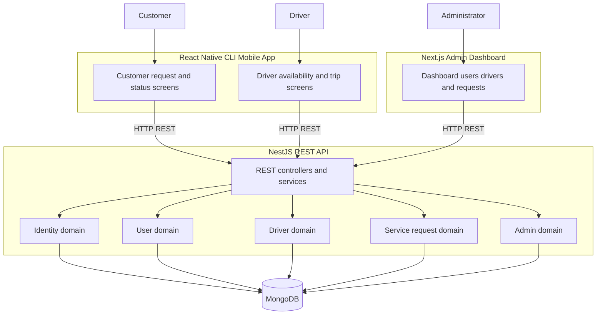
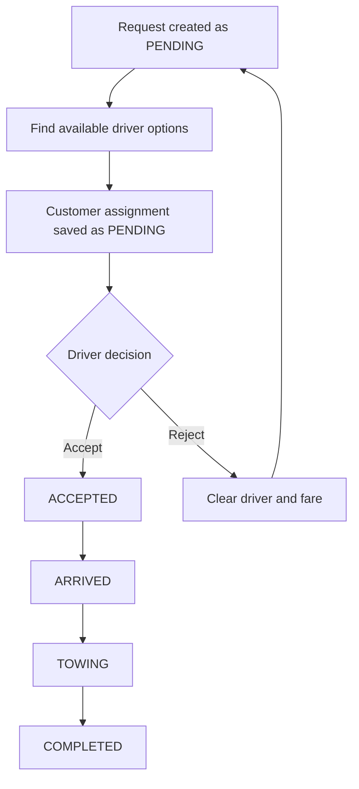
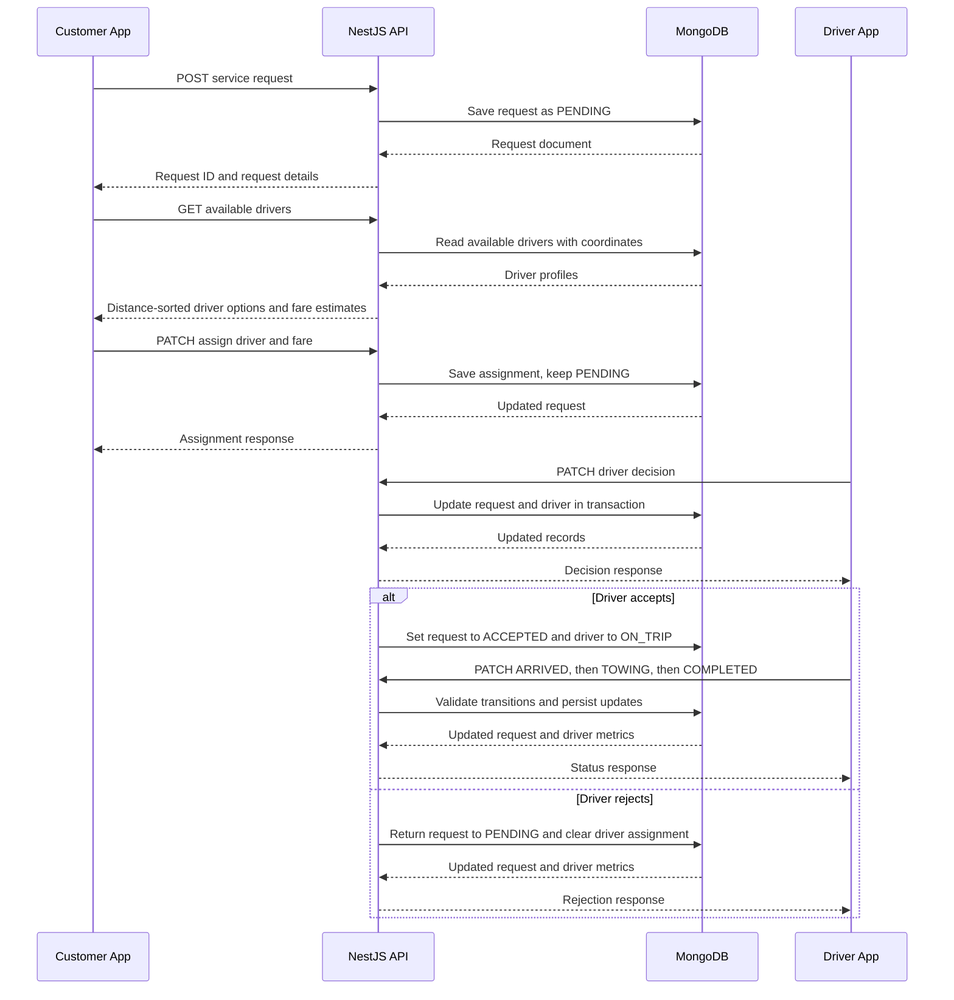
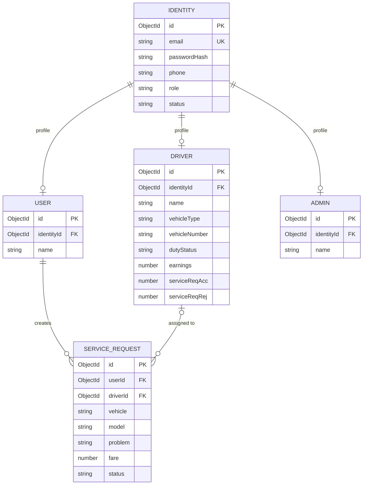

# Tow Me Now | System Architecture & Data Models

This document describes the current implementation of the **Tow Me Now** monorepo. It covers the application boundaries, backend domains, MongoDB/Mongoose models, service-request lifecycle, and known implementation gaps. It does not describe planned services as if they were already deployed.

---

## 1. System Context

Tow Me Now is organized as a Turborepo/npm-workspaces monorepo containing a React Native CLI mobile app, a Next.js admin dashboard, and a NestJS REST API. MongoDB is the backend's persistent datastore.



### Monorepo topology

```text
tow-me-now/
├── apps/
│   ├── server/       # NestJS API, domain modules, Mongoose schemas
│   ├── web-admin/    # Next.js App Router dashboard and API client
│   └── mobile-app/   # React Native CLI app for customers and drivers
├── package.json      # npm workspaces and root scripts
└── turbo.json        # Turborepo task configuration
```

Backend source is divided into `apps/server/src/domain/identity`, `user`, `driver`, `service-request`, and `admin`; shared enums and utilities are in `apps/server/src/shared`.

---

## 2. Application Responsibilities

| Application | Current responsibilities |
|---|---|
| **Mobile app** (`apps/mobile-app`) | Customer registration/login screens, roadside request entry, available-driver selection, request status UI, driver home and en-route screens, driver profile and vehicle settings. The customer flow uses device geolocation and OpenStreetMap Nominatim for address search/reverse geocoding. |
| **Admin dashboard** (`apps/web-admin`) | Login, dashboard analytics, user and driver lists, service-request list with search/status filters, driver account status management. Built with Next.js, React, TypeScript, and Tailwind CSS. |
| **Backend API** (`apps/server`) | Identity/login, user and driver profiles, duty/location updates, service-request creation and progression, driver selection calculations, and admin listing/analytics endpoints. |
| **MongoDB** | Stores identities, user profiles, driver profiles, admin profiles, and service requests through Mongoose. |

### Backend domains

* **Identity:** Stores credentials, contact details, account role/status; verifies login and issues JWT access tokens.
* **User:** Creates and retrieves customer profile records linked to an identity.
* **Driver:** Creates driver profiles, updates duty and current location, finds available drivers, and tracks driver metrics.
* **Service request:** Creates towing requests, calculates nearby-driver options and fare estimates, assigns a chosen driver, processes driver decisions, advances trip status, and provides en-route/admin views.
* **Admin:** Creates admin profiles, returns user/driver/request lists and dashboard analytics, and updates a driver's identity status.

---

## 3. Actors, Roles, and Account States

The backend role enum is `USER`, `DRIVER`, and `ADMIN`.

| Actor / role | Primary capabilities |
|---|---|
| `USER` | Creates a service request and selects a driver from available-driver results. |
| `DRIVER` | Sets duty status and location, views assigned pending requests, accepts or rejects a request, and advances an accepted trip. |
| `ADMIN` | Uses dashboard endpoints to view users, drivers, service requests, and analytics; may update a driver's account status. |

Identity account statuses are `PENDING`, `ACTIVE`, and `DEACTIVE`. Login rejects deactivated and pending identities; the identity schema defaults new records to `PENDING`.

Driver duty statuses are `OFFLINE`, `AVAILABLE`, and `ON_TRIP`. Driver matching uses `AVAILABLE` drivers with non-null latitude and longitude.

> **Authorization status:** Login issues JWTs, and the admin web API client can send a bearer token. The reviewed backend controllers do not apply JWT authentication guards or role guards to routes. Authentication and role-based API access must be enforced before production use.

---

## 4. Request Lifecycle

### Service-request status enum

The backend enum in `apps/server/src/shared/enums/service-status.enum.ts` contains:

`PENDING`, `ACCEPTED`, `ARRIVED`, `TOWING`, `COMPLETED`, `REJECTED`, `CANCELLED`

### Implemented state transitions



1. A customer request is created with `PENDING` status, no driver, and fare `0`.
2. The API calculates available-driver options. The customer chooses a driver; assignment saves the driver and selected fare while the request remains `PENDING`.
3. The assigned driver accepts or rejects:
   * **Accept:** request becomes `ACCEPTED`; driver duty changes to `ON_TRIP` and acceptance count increments.
   * **Reject:** request returns to the available pool as `PENDING`; driver assignment is cleared, fare resets to `0`, and driver duty changes to `AVAILABLE` with rejection count incremented.
4. Trip progress is guarded by expected current status: `ACCEPTED` → `ARRIVED` → `TOWING` → `COMPLETED`.
5. On completion, the fare is added to driver earnings and driver duty is set to `OFFLINE`.

Driver decision and completion-related updates use MongoDB sessions and transactions. The service-request schema does not store a separate status history or transition audit log.

`REJECTED` and `CANCELLED` are valid enum values, but the reviewed service logic does not implement them as distinct terminal request flows. Driver rejection is a return to `PENDING`.

### Request interaction sequence



### Driver matching and estimate calculation

The service filters for drivers whose duty is `AVAILABLE` and whose current latitude/longitude are set. It computes distance with the Haversine formula, rounds to one decimal kilometer, calculates estimated fare based on vehicle type, and sorts options nearest-first.

| Vehicle type | Base fare | Rate per km |
|---|---:|---:|
| `HOOK_AND_CHAIN` | 1,000 | 50 |
| `WHEEL_LIFT` | 1,500 | 70 |
| `FLAT_BED` | 2,500 | 100 |

The formula in the current service is `base fare + round(distance in km × rate per km)`. These are code-defined estimates, not a configurable tariff service.

---

## 5. REST API Surface

The NestJS application sets the global prefix to `/api` and URI versioning with default version `1`. The base path is `/api/v1`.

| Method | Route | Purpose |
|---|---|---|
| `POST` | `/identity/login` | Verify credentials and return an access token/profile. |
| `POST` | `/user` | Create a user identity and profile. |
| `POST` | `/driver` | Create a driver identity and profile. |
| `PATCH` | `/driver/toggle-duty` | Update a driver's duty status and current location. |
| `POST` | `/service-request` | Create a service request. |
| `GET` | `/service-request/:id/available-drivers` | Calculate and list available drivers and fare estimates. |
| `PATCH` | `/service-request/:id/assign` | Assign a selected driver and fare. |
| `GET` | `/service-request/driver/:driverId` | Fetch requests assigned to a driver that remain `PENDING`. |
| `PATCH` | `/service-request/:id/decision` | Accept or reject an assigned request. |
| `GET` | `/service-request/:id/en-route` | Return request and associated customer/driver details. |
| `PATCH` | `/service-request/:id/status` | Update the trip lifecycle status. |
| `POST` | `/admin` | Create an admin profile. |
| `GET` | `/admin/users` | List users for administration. |
| `GET` | `/admin/drivers` | List drivers for administration. |
| `GET` | `/admin/service-requests` | List service requests for administration. |
| `GET` | `/admin/analytics/dashboard` | Return dashboard analytics. |
| `PATCH` | `/admin/driver/:identityId/status` | Update a driver's identity account status. |

This table documents controller routes in the current code; it does not imply these routes are protected by role-based authorization.

---

## 6. MongoDB Data Model

The following ER diagram represents the Mongoose documents and references in the current backend. All profile and request schemas use MongoDB ObjectIds; schemas with timestamps receive `createdAt` and `updatedAt`.



### Schema details

#### `Identity`

* `email`: required, unique, lowercase, trimmed, indexed.
* `passwordHash`: required and excluded from normal query selection (`select: false`); created using bcrypt.
* `phone`: required and trimmed.
* `role`: required enum (`USER`, `DRIVER`, `ADMIN`), indexed.
* `status`: required enum (`PENDING`, `ACTIVE`, `DEACTIVE`), default `PENDING`.

#### `User`

* `name`: required and trimmed.
* `identityId`: required unique reference to `Identity`.

#### `Driver`

* `name`: required and trimmed.
* `identityId`: required unique reference to `Identity`.
* `vehicleType`: required enum (`HOOK_AND_CHAIN`, `WHEEL_LIFT`, `FLAT_BED`).
* `vehicleNumber`: required, trimmed, uppercase.
* `cnic`, `license`, `vehiclePaper`, `profile`: optional string fields.
* `earnings`, `serviceReqAcc`, `serviceReqRej`: numeric counters defaulting to `0`.
* `dutyStatus`: enum (`OFFLINE`, `AVAILABLE`, `ON_TRIP`), default `OFFLINE`.
* `currentLocation`: latitude, longitude, and address; each defaults to `null`.

#### `Admin`

* `name`: required and trimmed.
* `identityId`: required unique reference to `Identity`.

#### `ServiceRequest`

* Stored in the `service_requests` collection; has timestamps.
* `userId`: required indexed reference to `User`.
* `driverId`: nullable indexed reference to `Driver`.
* `vehicle`, `model`, `problem`: required trimmed strings.
* `pickupLoc`, `dropoffLoc`: required embedded values with numeric latitude/longitude and required address.
* `fare`: number defaulting to `0`.
* `status`: indexed service-status enum, default `PENDING`.

No separate tracking-log, payment, notification, or status-history schema was found in the reviewed backend domain.

---

## 7. Location and Real-Time Behavior

* The customer mobile screen gets the device's current position and resolves addresses using OpenStreetMap Nominatim.
* The driver's `currentLocation` is stored on the driver profile and updated through the duty-toggle endpoint.
* Driver matching reads the stored driver coordinates when calculating nearby options.
* The API provides an en-route details endpoint, but this returns request/profile data; it is not a continuous location stream.
* The reviewed repository does not implement Socket.IO/WebSocket gateways, Redis buffering, offline telemetry batch upload, scheduled persistence, or continuous background location reporting.
* The mobile customer trip-status screen uses local screen state for its progress display rather than receiving live server updates.

Accordingly, current behavior is request/status REST interaction plus stored driver location—not production live tracking.

---

## 8. Security and Operational Notes

* Passwords are bcrypt-hashed, and `passwordHash` is excluded from default Mongoose selection.
* Login checks identity status and issues a JWT containing the identity subject, email, and role.
* The reviewed controllers have no JWT or role guards. Protect identity, driver, customer, and admin endpoints and validate resource ownership before production.
* The service-request controller accepts identity IDs from request bodies/route parameters in the reviewed implementation; server-side actor binding and authorization are needed.
* MongoDB transactions are used for coordinated driver/request changes. Transaction support depends on running MongoDB as a replica set or on a compatible managed deployment.
* The backend enables CORS with `origin: true`; production deployments should define an explicit trusted-origin policy.

---

## 9. Mermaid Compatibility

Diagrams in this document use GitHub-supported Mermaid `flowchart`, `sequenceDiagram`, and `erDiagram` syntax. They document implemented architecture only; planned infrastructure should be added here when it is implemented and verified in code.
